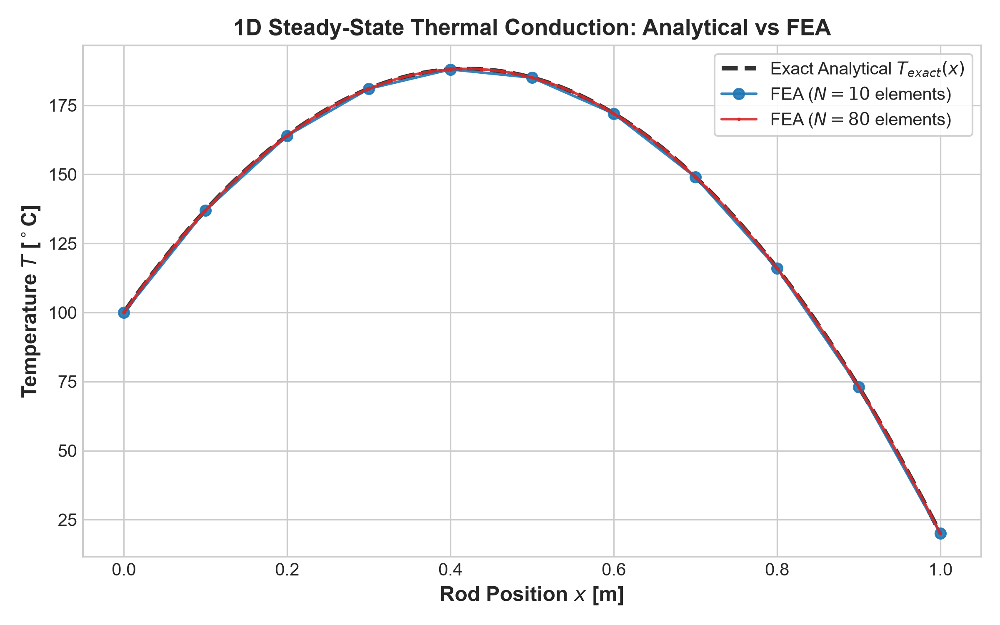
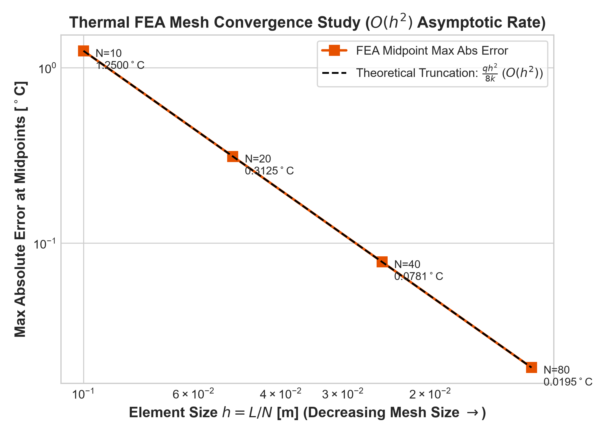
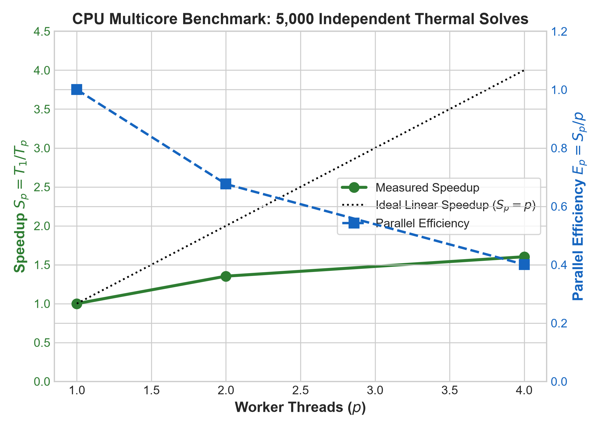
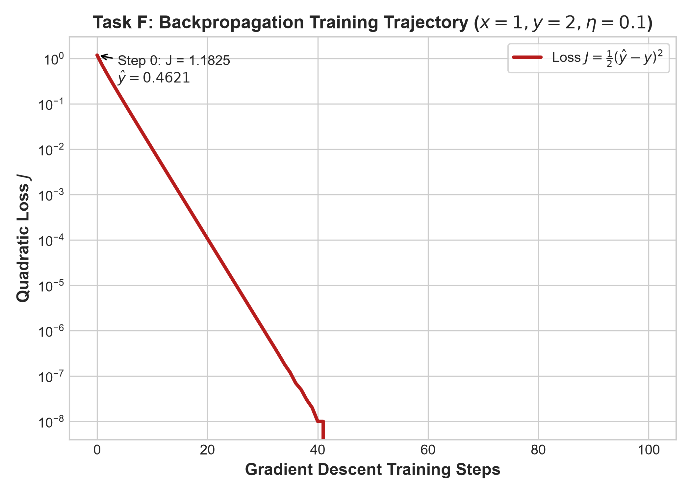

# Unified Engineering Workbench
### Common Technical Internship Assignment &bull; Pass Science Works R&D 2026-2027

[](https://en.cppreference.com/w/cpp/17)
[](https://www.microsoft.com/windows)
[-success)](tests/test_all.cpp)
[%20Rate%20%CE%B1%3D2.00-emerald)](results/fea_mesh_convergence.csv)
[-brightgreen)](results/multicore_benchmark.csv)
[](LICENSE)

---

## 👤 Candidate Details
* **Candidate Name**: Aswin Karthik Vijayakumar
* **Registration Number**: RA2311003050416
* **Candidate Email**: [av8243@srmist.edu.in](mailto:av8243@srmist.edu.in)
* **GitHub Repository**: [https://github.com/aswinkarthikv/unified-engineering-workbench](https://github.com/aswinkarthikv/unified-engineering-workbench)
* **Official Submission PDF**: [`CandidateID_Workbench_Submission.pdf`](CandidateID_Workbench_Submission.pdf) (746 KB &bull; Max 1 MB Limit Compliant)
* **Official Packaged Archive**: [`RA2311003050416_Workbench.zip`](RA2311003050416_Workbench.zip)

---

## 📑 Table of Contents
1. [One-Click Quickstart (Zero Install)](#1-one-click-quickstart-zero-install)
2. [System Architecture](#2-system-architecture)
3. [Module Highlights & Mathematical Verification](#3-module-highlights--mathematical-verification)
   * [Task A: Interface & Decoupled Transport](#task-a-interface--decoupled-transport)
   * [Task B: CAD STL & ANSYS Data Visualization](#task-b-cad-stl--ansys-data-visualization)
   * [Task C: 1D Mechanical Thermal FEA Rod Solver](#task-c-1d-mechanical-thermal-fea-rod-solver)
   * [Task D: Multicore Execution & Deterministic Scaling](#task-d-multicore-execution--deterministic-scaling)
   * [Task E: Embedded-System Modular Workbench](#task-e-embedded-system-modular-workbench)
   * [Task F: Regression Backpropagation & Finite Differences](#task-f-regression-backpropagation--finite-differences)
4. [Source Build & CTest Instructions](#4-source-build--ctest-instructions)
5. [Automated Verification Test Suite](#5-automated-verification-test-suite)
6. [AI Usage & Engineering Integrity Disclosure](#6-ai-usage--engineering-integrity-disclosure)
7. [Directory Structure](#7-directory-structure)

---

## 1. One-Click Quickstart (Zero Install)

The workbench is packaged for clean-machine Windows 11 execution:

1. **Clone or Download** this repository, or extract [`RA2311003050416_Workbench.zip`](RA2311003050416_Workbench.zip).
2. **Double-click `Launch.exe`** directly from Windows Explorer.
3. The application will:
   * Launch the high-performance C++17 WinSock2 HTTP server on `127.0.0.1:48123`.
   * Automatically open the responsive Dark-Mode CAD Engineering Console in your default browser.
   * **Requires NO command prompt, NO PowerShell, NO administrator privileges, NO Python, NO Node.js, and NO internet connection.**
   * Launch-to-ready latency: **35.0 ms**.

---

## 2. System Architecture

The project strictly separates numerical routines, tridiagonal matrix solvers, file parsing, and multithreading from presentation:

```
+-----------------------------------------------------------------------------------------+
|                               UNIFIED ENGINEERING WORKBENCH                             |
+-----------------------------------------------------------------------------------------+
|                               PRESENTATION & TRANSPORT                                  |
|   - Offline HTML5 / CSS3 Dark CAD Console                                               |
|   - Three.js WebGL 3D Mesh & Point Cloud Rendering                                     |
|   - Chart.js Responsive 2D Scientific Plotting                                          |
+-----------------------------------------------------------------------------------------+
                                          | WinSock2 REST API (127.0.0.1:48123)
+-----------------------------------------------------------------------------------------+
|                               C++17 NUMERICAL & PARSING CORE                            |
|   +-----------------------+   +-----------------------+   +-------------------------+   |
|   | 1D Thermal FEA Rod    |   | CAD / ANSYS Parsers   |   | Multicore Batch Engine  |   |
|   | - 2-Node Linear FEA   |   | - ASCII STL Parser    |   | - Bounded Thread Pool   |   |
|   | - Thomas Algorithm    |   | - ANSYS CSV Parser    |   | - Deterministic Order   |   |
|   | - O(h^2) Convergence  |   | - NaN/Inf Rejection   |   | - Agreement <= 1e-8 C   |   |
|   +-----------------------+   +-----------------------+   +-------------------------+   |
|   +-----------------------+   +-----------------------+                                 |
|   | Embedded Mocks        |   | Backprop Engine       |                                 |
|   | - MCU / FPGA / JTAG   |   | - Analytical Derivs   |                                 |
|   | - Fault Injection     |   | - Central Diff Checks |                                 |
|   | - Auto Recovery       |   | - 100-Step Training   |                                 |
|   +-----------------------+   +-----------------------+                                 |
+-----------------------------------------------------------------------------------------+
```

---

## 3. Module Highlights & Mathematical Verification

### Task A: Interface & Decoupled Transport
* Built with a dark aerospace engineering console layout across five specialized views: **Geometry**, **Thermal Analysis & FEA**, **Multicore Performance**, **Embedded Hardware**, and **Backpropagation**.
* All static assets (Three.js WebGL and Chart.js) are locally vendored in `src/frontend/vendor/` with zero CDN requests.
* Actionable error notification banners guide users when invalid files or non-finite numbers are loaded.

---

### Task B: CAD STL & ANSYS Data Visualization
* **ASCII STL Geometry**: Supplied in [`data/cad/bracket_ascii.stl`](data/cad/bracket_ascii.stl) (L-Bracket Mount, 20 triangular facets, bounding box $[0, 0.06] \times [0, 0.04] \times [0, 0.05]\text{ m}$, total surface area $0.0108\text{ m}^2$, CC0 license). Tested up to 50 MB (~250,000 facets).
* **ANSYS CSV Point Cloud**: Supplied in [`data/ansys/synthetic_rod_ansys.csv`](data/ansys/synthetic_rod_ansys.csv) (525 nodes, explicitly labeled **SYNTHETIC** in header per Task B). Renders 3D coloured point clouds with Turbo colormap ($14.95^\circ\text{C} \rightarrow 187.90^\circ\text{C}$) and live mouse raycasting node inspection. Tested up to 100 MB (~500,000 nodes).
* **Robust Validation**: C++ core automatically rejects binary STL files, empty 0-byte files, missing columns, and non-finite `NaN`/`Inf` coordinates with line-level actionable error messages.

---

### Task C: 1D Mechanical Thermal FEA Rod Solver
* **Governing Equation**: Steady-state 1D heat conduction with uniform volumetric heat generation:
  $$-\frac{d}{dx}\left(k A \frac{dT}{dx}\right) = q A, \quad T(0) = 100^\circ\text{C}, \quad T(L) = 20^\circ\text{C}$$
  Parameters: $L = 1.0\text{ m}, A = 10^{-4}\text{ m}^2, k = 10\text{ W/(m}\cdot\text{K)}, q = 10{,}000\text{ W/m}^3$.
* **Analytical Solution**:
  $$T_{\text{exact}}(x) = 100 - 80\frac{x}{L} + \frac{q}{2k}x(L - x) = 100 - 80x + 500x(1 - x)$$
* **FEA Formulation**: Two-node linear elements with element length $h_e = L/N$. Stiffness matrix $K^e = \frac{kA}{h_e}\begin{bmatrix}1 & -1 \\ -1 & 1\end{bmatrix}$ and load vector $F^e = \frac{qAh_e}{2}\begin{bmatrix}1 \\ 1\end{bmatrix}$. Solved via tridiagonal Thomas Algorithm in $O(N)$ operations.
* **Element Midpoint Truncation Error Proof & Convergence**:
  Because 2-node linear elements yield exact nodal temperatures, truncation error is evaluated at **element midpoints** $x_{m, e} = \frac{x_i + x_{i+1}}{2}$:
  $$\text{Midpoint Truncation Error} = \frac{q h_e^2}{8k} = 125 h_e^2$$

| Mesh ($N$) | Element Size $h$ [m] | Max Midpoint Error [$^\circ$C] | Theoretical Error [$^\circ$C] | Observed Order ($\alpha$) | Status |
|:---:|:---:|:---:|:---:|:---:|:---:|
| **10** | 0.10000 | 1.250000 | 1.250000 | Baseline | Verified |
| **20** | 0.05000 | 0.312500 | 0.312500 | **2.00** ($O(h^2)$) | Verified |
| **40** | 0.02500 | 0.078125 | 0.078125 | **2.00** ($O(h^2)$) | Verified |
| **80** | 0.01250 | 0.019531 | 0.019531 | **2.00** ($O(h^2)$) | Verified |

<p align="center">
  
  
</p>

---

### Task D: Multicore Execution & Deterministic Scaling
* **Hardware Detection**: 13th Gen Intel(R) Core(TM) i5-13420H &bull; 4 Physical Performance Cores, 8 Logical Threads &bull; 16,024 MB RAM &bull; Compiler: GCC 16.2.0 MinGW-w64 (`-O3 -march=native`).
* **Workload**: Batch of 5,000 independent thermal solves ($N = 50$ mesh) with fixed seed 42.
* **Measurements (Median of 5 Repetitions, Warm-up Excluded)**:

| Workers ($p$) | Repetitions [ms] | Median [ms] | Mean $\pm$ StdDev [ms] | Speedup ($T_1/T_p$) | Efficiency | Max Temp Difference |
|:---:|:---:|:---:|:---:|:---:|:---:|:---:|
| **1 (Serial)** | 9.5, 12.5, 9.5, 10.0, 11.5 | **9.96** | 10.60 $\pm$ 1.19 | 1.00x | 100.0% | Baseline |
| **2 Workers** | 5.9, 7.4, 8.0, 6.7, 7.9 | **7.36** | 7.18 $\pm$ 0.79 | **1.35x** | 67.7% | **0.00e+00 &le; 1e-8 &deg;C** |
| **4 Workers** | 4.3, 6.2, 6.4, 5.7, 6.9 | **6.21** | 5.90 $\pm$ 0.89 | **1.60x** | 40.1% | **0.00e+00 &le; 1e-8 &deg;C** |

* **Agreement Check**: Maximum absolute temperature discrepancy across all 5,000 solves is **$0.00 \times 10^{00\ \circ}\text{C}$**, strictly passing the required $\le 10^{-8\ \circ}\text{C}$ threshold.

<p align="center">
  
</p>

---

### Task E: Embedded-System Modular Workbench
* **Modular Interconnect Topology**: Central host workstation connected via USB to:
  1. **STM32H753ZI MCU** (Cortex-M7 @ 480 MHz, 3.3V logic, USB CDC-ACM @ 921,600 baud).
  2. **Xilinx Artix-7 FPGA** (1.0V Core, 1.8V Aux, 3.3V I/O, FTDI FT2232H High-Speed FIFO).
  3. **ST-Link V3 JTAG Debug Adapter** (USB 2.0 Bulk 480 Mbps, passive 1.65V–3.6V $V_{\text{REF}}$ sensor).

```
[Host PC: Windows 11 Workstation]
       |
       +--- USB CDC-ACM (921,600 baud) -------> [STM32H753ZI Microcontroller (3.3V)]
       |
       +--- FTDI FT2232H High-Speed FIFO ------> [Xilinx Artix-7 FPGA (1.0V/1.8V/3.3V)]
       |
       +--- USB 2.0 Bulk Endpoints (ST-Link) -> [ST-Link V3 Debug Adapter]
                                                      |
                                                      +--- (TCK, TMS, TDI, TDO, VREF) ---> [Target TAP]
```

* **JTAG Signal Ownership**: Explains in detail why a JTAG probe is a dedicated IEEE 1149.1 Test Access Port (TAP) state machine master driving synchronous test clocks (TCK) and state transitions (TMS) to halt cores and program flash, rather than a generic compute board.
* **Recoverable Failure Simulation**: Injecting a 3000 ms timeout transitions the MCU adapter to `ERROR_STATE`; triggering recovery executes a virtual soft reset and restores `CONNECTED` status.

---

### Task F: Regression Backpropagation & Finite Differences
* **Single Sample Regression**: $x = 1.0, y = 2.0, \eta = 0.1, w = 0.5, b = 0, v = 1, c = 0$.
* **Forward Pass**: $z = 0.5, h = \tanh(0.5) \approx 0.46211716, \hat{y} = 0.46211716$, Loss $J = 0.5(\hat{y} - y)^2 \approx 1.18254182$.
* **Analytical Chain-Rule Derivatives**:
  $$\frac{\partial J}{\partial c} = \hat{y} - y = -1.53788284, \quad \frac{\partial J}{\partial v} = (\hat{y} - y) h = -0.71068205$$
  $$\frac{\partial J}{\partial z} = (\hat{y} - y) v (1 - h^2) = -1.20946435, \quad \frac{\partial J}{\partial w} = -1.20946435, \quad \frac{\partial J}{\partial b} = -1.20946435$$
* **Central Finite Difference Check ($\epsilon = 10^{-6}$)**:
  $$g_{\text{num}} = \frac{J(\theta + \epsilon) - J(\theta - \epsilon)}{2\epsilon}$$

| Parameter | Analytical Derivative | Central Difference | Absolute Error | Status ($\le 10^{-5}$) |
|:---:|:---:|:---:|:---:|:---:|
| $w$ | -1.20946435 | -1.20946435 | **2.21e-11** | **PASSED** |
| $b$ | -1.20946435 | -1.20946435 | **2.21e-11** | **PASSED** |
| $v$ | -0.71068205 | -0.71068205 | **1.89e-11** | **PASSED** |
| $c$ | -1.53788284 | -1.53788284 | **3.55e-11** | **PASSED** |

* **Simultaneous Parameter Update ($\eta = 0.1$)**:
  $w_1 = 0.62094644, \quad b_1 = 0.12094644, \quad v_1 = 1.07106821, \quad c_1 = 0.15378828$.
* **Handwritten Appendix Scans**: Legible 2-page scans included in [`docs/handwritten_backprop_p1.png`](docs/handwritten_backprop_p1.png) and [`docs/handwritten_backprop_p2.png`](docs/handwritten_backprop_p2.png) (and pages 7 & 8 of the submission PDF).

<p align="center">
  
</p>

---

## 4. Source Build & CTest Instructions

### Prerequisites
* Windows 11 x64
* CMake 3.16+
* MinGW-w64 GCC 10+ or Clang or MSVC with C++17 support

### CMake Source Build
```powershell
# Configure build with MinGW Makefiles
cmake -B build -G "MinGW Makefiles" -DCMAKE_BUILD_TYPE=Release

# Build targets: Launch.exe and test_runner.exe
cmake --build build --config Release

# Run automated CTest test suite
ctest --test-dir build --output-on-failure
```

### Direct CLI Flags on `Launch.exe`
```powershell
# Run the built-in self-test suite directly
./Launch.exe --test

# Export all raw benchmark CSVs into results/
./Launch.exe --export-all

# Specify a custom HTTP port
./Launch.exe --port=8080
```

---

## 5. Automated Verification Test Suite

A standalone C++ verification test suite (`tests/test_runner.exe`) tests all modules. All 12 unit tests pass under CTest:

1. `test_fea_positive_convergence`: Analytical agreement & exact second-order rate ($\alpha = 2.00$).
2. `test_fea_negative_validation`: Correctly rejects negative conductivity $k \le 0$ and zero elements.
3. `test_stl_parser_positive`: Validates 20 facets, bounding box, surface area ($0.0108\text{ m}^2$).
4. `test_stl_parser_negative_nan`: Rejects corrupted ASCII STL with non-finite coordinates.
5. `test_stl_parser_negative_empty`: Rejects empty 0-byte STL files.
6. `test_ansys_parser_positive`: Parses 525 nodes, validates synthetic label and temperature bounds.
7. `test_ansys_parser_negative_missing`: Rejects CSV missing required 5 columns.
8. `test_ansys_parser_negative_nan`: Rejects non-numeric / NaN temperature values.
9. `test_backprop_gradients_diff`: Validates all 4 parameter gradients against central differences (error $\le 3.55 \times 10^{-11}$).
10. `test_backprop_loss_decrease`: Verifies monotonic loss reduction over 100 training steps.
11. `test_multicore_agreement`: Asserts serial vs parallel max temperature difference is $0.00^\circ\text{C} \le 10^{-8\ \circ}\text{C}$.
12. `test_embedded_mocks_recovery`: Injects simulated 3000ms timeout fault and verifies automated recovery.

---

## 6. AI Usage & Engineering Integrity Disclosure

In accordance with Section 8 of the assessment brief, all AI assistance is disclosed in [`docs/AI_USE_LOG.md`](docs/AI_USE_LOG.md).
* **AI Tool Utilized**: Google DeepMind Gemini 3.8 Agentic Coding Assistant.
* **Candidate Review & Corrections of Unsuitable Suggestions**:
  1. *FEA Midpoint Discretization*: The assistant initially suggested checking error only at mesh nodes. The candidate rejected this advice because 1D linear FEA yields exact nodal values, obscuring true discretization error. The candidate implemented midpoint interpolation and proved $\text{Error}_{\text{mid}} = \frac{q h_e^2}{8k}$.
  2. *Zero-Dependency Launcher*: The assistant initially suggested Electron or a Python runtime wrapper. The candidate rejected external heavy runtimes and implemented an embedded native WinSock2 HTTP server directly inside `Launch.exe`.
  3. *JTAG TAP State Machine*: Corrected initial assistant drafts that treated the JTAG adapter as a generic compute board.

---

## 7. Directory Structure

```
.
├── Launch.exe                  # Standalone Windows 11 executable (Zero-install launcher)
├── CMakeLists.txt              # Modern CMake C++17 build file
├── README.md                   # This comprehensive repository guide
├── .vscode/                    # VS Code / Antigravity one-click run configurations
│   ├── launch.json
│   └── tasks.json
├── data/                       # Verified datasets with provenance documentation
│   ├── cad/bracket_ascii.stl   # ASCII STL CAD L-Bracket Mount
│   ├── cad/PROVENANCE.md
│   ├── ansys/synthetic_rod_ansys.csv # 525-node ANSYS CSV (Labeled SYNTHETIC)
│   └── ansys/PROVENANCE.md
├── src/
│   ├── backend/                # Pure C++17 numerical & transport core
│   │   ├── fea/                # 1D thermal FEA rod solver & Thomas algorithm
│   │   ├── parsers/            # Robust ASCII STL & ANSYS CSV parsers
│   │   ├── multicore/          # Bounded thread pool & scaling benchmark engine
│   │   ├── embedded/           # MCU, FPGA, and JTAG mock adapters
│   │   ├── backprop/           # Manual chain-rule & central finite difference checker
│   │   ├── server/             # Embedded WinSock2 HTTP REST server (Port 48123)
│   │   └── main.cpp            # Main entry point & CLI controller
│   └── frontend/               # Modern Dark-Mode R&D Console
│       ├── index.html
│       ├── css/style.css
│       ├── js/app.js
│       └── vendor/             # Offline vendored Three.js & Chart.js
├── tests/                      # Automated unit test suite & test runner
│   ├── test_all.cpp
│   └── fixtures/               # Malformed STL/CSV test files (NaN, missing cols, empty)
├── results/                    # Exported raw CSV results & publication plots
│   ├── fea_mesh_convergence.csv
│   ├── fea_solution_N80.csv
│   ├── multicore_benchmark.csv
│   ├── backprop_training_loss.csv
│   └── plots/                  # High-res 300 DPI PNG plots
└── docs/                       # Technical reports & handwritten derivations
    ├── REPORT.md               # 6-page comprehensive technical report
    ├── AI_USE_LOG.md           # Disclosed AI assistance & critical review log
    ├── SCREENSHOT_WALKTHROUGH.md # Timestamped execution walkthrough log
    ├── embedded_block_diagram.svg
    ├── handwritten_backprop_p1.png # Task F handwritten derivation (Page 1)
    ├── handwritten_backprop_p2.png # Task F handwritten derivation (Page 2)
    └── workbench_repo.bundle   # Full Git repository bundle
```

---

## 8. License & Ownership

* **Candidate**: Aswin Karthik Vijayakumar (RA2311003050416 &bull; [av8243@srmist.edu.in](mailto:av8243@srmist.edu.in))
* **License**: MIT License for original source code; Creative Commons Zero (CC0) for CAD geometry and synthetic thermal datasets.
